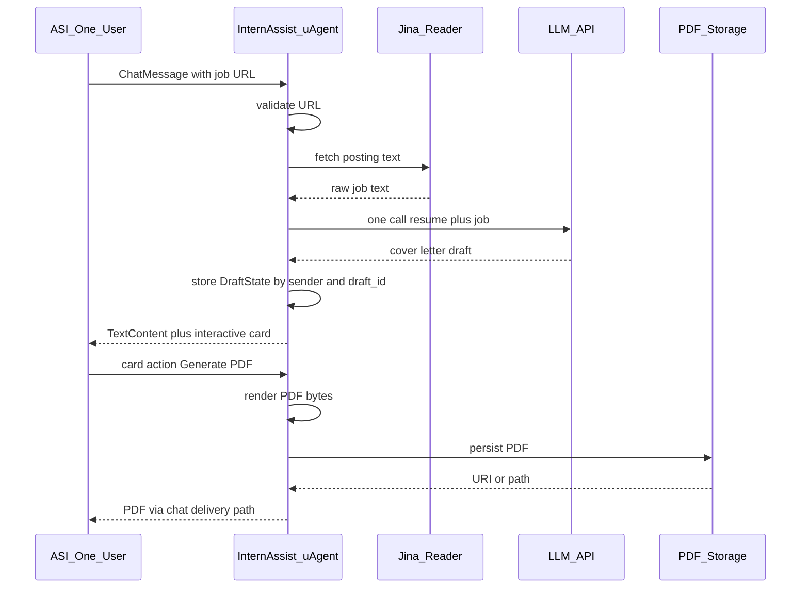

# InternAssist — Implementation Plan

Build-time budget: **6–7 hours** total. Platform: Windows PowerShell, Python. Constraints: no database, no web framework, no new dependency without justification ([AGENTS.md](../AGENTS.md) — **VERIFIED**).

Every claim below is tagged **VERIFIED** (cite file/doc/source) or **ASSUMED**. Do not treat ASSUMED items as proven until tests or official docs confirm them.

---

## 1. Current state

After the scaffold prompt ([docs/PROGRESS.md](PROGRESS.md) — **VERIFIED**):

| Item | Status | Tag |
|------|--------|-----|
| `backend/app/` modules | Docstring-only stubs (no feature logic) | **VERIFIED** — module files under `backend/app/` |
| `backend/tests/__init__.py` | Empty package init | **VERIFIED** |
| `backend/output/.gitkeep` | Present; output dir gitignored except keep file | **VERIFIED** — [.gitignore](../.gitignore) |
| `backend/README.md` | Short placeholder | **VERIFIED** |
| `docs/ASI_INTEGRATION_NOTES.md` | Headings only (card schema, card action payload, chat protocol shapes, file delivery, reachability) | **VERIFIED** |
| `backend/.env.example` | Placeholders for AGENT_SEED, AGENT_NAME, AGENT_PORT, LLM_*, JINA_API_KEY, PDF_STORAGE, AGENTVERSE_API_KEY, OUTPUT_DIR | **VERIFIED** — [backend/.env.example](../backend/.env.example) |
| Real `.env` | Not created | **VERIFIED** — scaffold rules + progress ledger |
| Virtualenv | `.venv/` at repo root | **VERIFIED** — [docs/PROGRESS.md](PROGRESS.md) |

### Exact installed versions

**VERIFIED** — [backend/requirements.txt](../backend/requirements.txt) and scaffold session (`pip show` / `python --version`):

| Package / runtime | Version |
|-------------------|---------|
| Python | **3.11.9** |
| uagents | **0.26.1** |
| uagents-core | **0.4.12** |
| fpdf2 | **2.8.9** |
| httpx | **0.28.1** |
| pydantic | **2.14.1** |
| python-dotenv | **1.2.4** |
| openai | **3.37.0** |
| pytest | **9.1.1** |

### Scaffold module inventory

**VERIFIED** — each file exists with a responsibility docstring only:

- `backend/app/__init__.py`, `agent.py`, `config.py`, `models.py`, `session.py`
- `backend/app/handlers/__init__.py`, `chat_handler.py`, `card_actions.py`
- `backend/app/services/__init__.py`, `job_scraper.py`, `cover_letter_generator.py`, `pdf_generator.py`, `storage_service.py`
- `backend/app/cards/__init__.py`, `review_card.py`
- `backend/app/data/__init__.py`, `resume.py`
- `backend/app/utils/__init__.py`, `url_validator.py`, `logging_config.py`

---

## 2. Target architecture

### Module responsibilities

| File | Intended responsibility | Tag |
|------|-------------------------|-----|
| `app/agent.py` | Construct the uAgent, register chat/card handlers, run | **VERIFIED** — docstring |
| `app/config.py` | Load/validate settings from environment | **VERIFIED** — docstring |
| `app/models.py` | Shared models: job postings, cover letters, session/draft state | **VERIFIED** — docstring |
| `app/session.py` | In-memory session state for review-to-PDF flow | **VERIFIED** — docstring |
| `app/handlers/chat_handler.py` | Inbound chat: job URL intake and orchestration | **VERIFIED** — docstring |
| `app/handlers/card_actions.py` | Interactive card actions (e.g. Generate PDF) | **VERIFIED** — docstring |
| `app/services/job_scraper.py` | Fetch/extract job text (e.g. Jina Reader) | **VERIFIED** — docstring |
| `app/services/cover_letter_generator.py` | One LLM call: resume + job → one letter | **VERIFIED** — docstring |
| `app/services/pdf_generator.py` | Cover letter → formatted PDF | **VERIFIED** — docstring |
| `app/services/storage_service.py` | Persist/retrieve PDFs (local or Agentverse) | **VERIFIED** — docstring |
| `app/cards/review_card.py` | Build ASI:One review card | **VERIFIED** — docstring |
| `app/data/resume.py` | Load applicant resume | **VERIFIED** — docstring |
| `app/utils/url_validator.py` | Validate job-posting URL | **VERIFIED** — docstring |
| `app/utils/logging_config.py` | Logging without secrets / full letter dumps | **VERIFIED** — docstring |

### End-to-end flow

**ASSUMED** product sequence (matches [AGENTS.md](../AGENTS.md) product description — product intent **VERIFIED** in AGENTS; wiring details **ASSUMED** until implemented):

**Spike UI default (locked for planning):** Prefer showing the letter in chat `TextContent` plus a card CTA `Generate PDF` that carries `draft_id` in `selection`. Editable prefilled letter text is **unproven** — see Risk register and Open questions. **VERIFIED** installed schema: `FormField` and `InputNode` expose `placeholder` but no `default` / `value` field ([`.venv/Lib/site-packages/uagents_core/contrib/protocols/chat/cards/__init__.py`](../.venv/Lib/site-packages/uagents_core/contrib/protocols/chat/cards/__init__.py)).

---

## 3. Data models

Shapes below are **ASSUMED** (not implemented). They must only hold facts from loaded resume JSON / scrape / runtime — never invent resume content ([AGENTS.md](../AGENTS.md) — **VERIFIED** rule).

### Resume

| Field | Notes |
|-------|--------|
| `full_name` | e.g. fictional fixture "Alex Example" for tests |
| `email`, `phone`, `location` | Contact; omit if absent in JSON |
| `summary` | Optional short blurb |
| `education` | List of items (school, degree, dates, details as present) |
| `experience` | List of items (employer, title, dates, bullets as present) |
| `skills` | List of strings |
| `certifications` | List of strings (optional) |

### JobData

| Field | Notes |
|-------|--------|
| `url` | Validated public job URL |
| `title`, `company` | Parsed if available; may be empty |
| `location` | Optional |
| `raw_text` | Scraped body used for LLM context |
| `fetched_at` | Timestamp of scrape |

### DraftState

| Field | Notes |
|-------|--------|
| `draft_id` | UUID string created when letter is drafted |
| `sender` | Chat counterparty address / id from uAgents context |
| `job` | Embedded `JobData` |
| `letter_text` | Current draft body |
| `status` | e.g. `drafted` / `pdf_ready` / `failed` (**ASSUMED** enum) |
| `created_at`, `updated_at` | Timestamps |
| `pdf_asset_id` | Optional storage id after PDF persist |

### Keying drafts per sender and draft_id

**ASSUMED:**

- In-memory store only (no DB — **VERIFIED** [AGENTS.md](../AGENTS.md)).
- Lookup key: `(sender, draft_id)` → `DraftState` (or nested `sender → draft_id → DraftState`).
- On letter creation: generate `draft_id`, store state, put `draft_id` + action name in card CTA `selection`.
- On card action / revision: resolve state by `(sender, draft_id)` from selection or follow-up message; reject unknown/mismatched sender.

---

## 4. Phased task list

Budgets sum to ~6.5–7 hours. Order is fixed. Do not skip Phase 2.

### Phase 1 — Hygiene, config, resume privacy

| | |
|--|--|
| **Time budget** | 25 minutes |
| **Goal** | Load config from env; safe logging; resume privacy pattern |
| **Files touched** | `backend/app/config.py`, `backend/app/utils/logging_config.py`, `backend/app/data/resume.py`; add `backend/app/data/resume.example.json` (committed, fictional **Alex Example**); support gitignored `resume.local.json` (already in [.gitignore](../.gitignore) — **VERIFIED**) |
| **Done when** | Config fails clearly on missing required keys; resume loader prefers `resume.local.json` then falls back to example for tests; logs never print seed/API keys or full resume/letter |
| **Tests** | Unit: load example resume; reject missing file path; config validation with env fixtures (no real secrets) |

### Phase 2 — RISK SPIKE: ASI interactive card + PDF delivery (cap 60 min)

| | |
|--|--|
| **Time budget** | **60 minutes hard cap** |
| **Goal** | Prove interactive card renders in ASI:One and a PDF can be delivered (or document a working fallback) **before** building scrape/LLM/full flow |
| **Files touched** | Minimal path: `agent.py`, thin handlers, `cards/review_card.py`, `services/storage_service.py` and/or tiny spike script; record facts in `docs/ASI_INTEGRATION_NOTES.md` |
| **Done when** | Live or documented proof: (1) card appears and action returns to agent; (2) PDF reaches user via ResourceContent and/or TextContent link — whichever is verified. If blocked at 60m, lock fallback and proceed |
| **Tests** | Schema construction unit tests against `uagents_core` card helpers; live check is manual (you) |

Look first (**do not invent field names**): package `uagents_core.contrib.protocols.chat.cards` + README; Innovation Lab [ASI interactive cards](https://innovationlab.fetch.ai/resources/docs/interactive-cards/asi-interactive-cards); `uagents_core.storage.ExternalStorage` (**VERIFIED** sync `requests` in package source).

### Phase 3 — Job URL validation and Jina scraping

| | |
|--|--|
| **Time budget** | 40 minutes |
| **Goal** | Accept only sensible public http(s) URLs; fetch text via Jina Reader |
| **Files touched** | `utils/url_validator.py`, `services/job_scraper.py`, tests with mocked httpx |
| **Done when** | Invalid URLs rejected; empty/short scrapes fail with clear user message; happy-path mock returns `JobData` |
| **Tests** | Mocked HTTP; no live Jina in default CI |

### Phase 4 — Resume-grounded letter generation + deterministic guards

| | |
|--|--|
| **Time budget** | 55 minutes |
| **Goal** | Exactly **one** LLM call per draft; letter uses only resume facts; untrusted job/user text delimited as DATA |
| **Files touched** | `services/cover_letter_generator.py`, `models.py` as needed, tests with mocked OpenAI client |
| **Done when** | Guards fail closed on: placeholder tokens (`[Company]`, `TBD`, etc.), invented numbers/metrics not in resume, word-count out of band (**ASSUMED** band e.g. 250–400 words — tune in tests); prompt-injection fixture does not override resume rules |
| **Tests** | Deterministic mocks; fictional Alex Example only; no paid API by default |

### Phase 5 — PDF generator

| | |
|--|--|
| **Time budget** | 25 minutes |
| **Goal** | Render letter bytes with fpdf2 |
| **Files touched** | `services/pdf_generator.py`, tests writing under `backend/output/` (gitignored) |
| **Done when** | Given letter text → non-empty PDF bytes / file; Unicode handling strategy documented if limited |
| **Tests** | Fixture letter → PDF magic bytes `%PDF` |

### Phase 6 — Full flow: sessions, card actions, revisions, storage, delivery

| | |
|--|--|
| **Time budget** | 70 minutes |
| **Goal** | Wire chat → scrape → letter → card → Generate PDF → store → deliver; session keyed by sender + draft_id |
| **Files touched** | `session.py`, `handlers/*`, `cards/review_card.py`, `services/storage_service.py`, `agent.py` |
| **Done when** | End-to-end path works under mocks; card action resolves correct draft; revision path defined (chat edit or re-draft — **ASSUMED** simplest: accept edited text from follow-up or regenerate once) |
| **Tests** | Handler-level tests with fakes; no live ASI in default suite |

### Phase 7 — Go live on Agentverse / ASI:One

| | |
|--|--|
| **Time budget** | 45 minutes |
| **Goal** | Agent reachable from ASI:One (mailbox/endpoint as verified in docs) |
| **Files touched** | `agent.py`, `config.py`, README run notes; ASI notes updates |
| **Done when** | You can @mention / chat the agent with a public job URL and complete Generate PDF live (or documented fallback works live) |
| **Tests** | Manual live smoke only |

### Phase 8 — Hardening and tests

| | |
|--|--|
| **Time budget** | 40 minutes |
| **Goal** | Edge cases, logging hygiene, regression suite green |
| **Files touched** | tests under `backend/tests/`, small fixes in touched modules |
| **Done when** | `python -m pytest backend/tests -q` passes with mocks; no secrets in logs |
| **Tests** | Full mocked suite |

### Phase 9 — README and demo kit

| | |
|--|--|
| **Time budget** | 25 minutes |
| **Goal** | Someone else can run and demo |
| **Files touched** | `backend/README.md`; optional short demo script notes in docs |
| **Done when** | PowerShell activate/install/run steps; required env vars; demo URL guidance (public postings only); Alex Example called out for tests |
| **Tests** | N/A (doc review) |

### Phase 10 — Final audit

| | |
|--|--|
| **Time budget** | 20 minutes |
| **Goal** | AGENTS compliance, PROGRESS accurate, TODOs marked |
| **Files touched** | `docs/PROGRESS.md`, `docs/ASI_INTEGRATION_NOTES.md` as needed |
| **Done when** | No invented resume facts in code paths; secrets policy intact; open questions resolved or explicitly still open with citations |
| **Tests** | Re-run pytest |

### Optional — Landing page

Only if phases 1–10 pass and time remains. Not on the critical path. Drop first under the cut line.

---

## 5. Risk register

| Risk | Early detection | Fallback |
|------|-----------------|----------|
| Prefill editable letter text may not be supported by card schema | Phase 2 spike: attempt form/custom; compare against installed schemas + [ASI interactive cards](https://innovationlab.fetch.ai/resources/docs/interactive-cards/asi-interactive-cards). **VERIFIED** gap: no `default`/`value` on `FormField`/`InputNode` in uagents-core 0.4.12 | Letter in `TextContent` and/or `ReviewCardPayload.summary_rows`; edits via follow-up chat; or accept-as-is + Generate PDF |
| File / PDF delivery may not work as expected in ASI:One | Phase 2 spike: try `ExternalStorage` + `ResourceContent` (and any documented alternate); confirm in chat protocol docs | Download URL in `TextContent`; local file for recorded demo |
| Jina returns junk for login-walled pages | Phase 3: min length / quality checks; fixture tests | Ask for a public URL; refuse paywalled/empty scrapes |
| LLM fabricates resume facts | Phase 4 guards + prompt-injection test with Alex Example | One regenerate attempt or fail closed with user-visible error |

Additional delivery risk (**ASSUMED** until spike): mailbox vs endpoint reachability misconfig — detect in Phase 7 inspector / Agentverse status; fallback: local mailbox agent per official local-agent docs.

---

## 6. Open questions (verify; do not guess)

| # | Question | Where to look |
|---|----------|---------------|
| 1 | Exact card schema for review UX; whether any official path supports **prefilled editable** letter text | Installed: `uagents_core.contrib.protocols.chat.cards` (+ `cards/README.md`); docs: [ASI:One Interactive Cards](https://innovationlab.fetch.ai/resources/docs/interactive-cards/asi-interactive-cards), [Card Playground](https://innovationlab.fetch.ai/resources/docs/interactive-cards/asi-card-playground). Record answers in `docs/ASI_INTEGRATION_NOTES.md` with URL + date |
| 2 | Card-action **payload shape** returned to the agent (JSON in `TextContent` vs `MetadataContent` / `extract_card_response`, prose vs JSON) | Same cards README + ASI docs “Response format”; helpers `create_card_response_content` / `extract_card_response` |
| 3 | Agentverse **storage API** contract and whether callers must treat it as blocking | Package: `uagents_core.storage.ExternalStorage` (**VERIFIED** uses sync `requests`); official Agentverse storage docs for HTTP semantics; wrap with `asyncio.to_thread` in async handlers per [AGENTS.md](../AGENTS.md) |
| 4 | **Mailbox vs endpoint** setup for ASI:One reachability | `uagents.agent.Agent` params (`mailbox`, `endpoint`, `seed`, `port`) in installed `uagents/agent.py`; Agentverse + Local Agents docs on Innovation Lab / Fetch docs site |
| 5 | Chat protocol **content types** for file delivery (`Resource` / `ResourceContent` mime_type + role; any ASI:One-specific PDF quirks) | `uagents_core.contrib.protocols.chat` (**VERIFIED** content types include `TextContent`, `ResourceContent`, `MetadataContent`, session/stream types; protocol name/version `AgentChatProtocol` / `0.3.0`); [Agent Chat Protocol](https://innovationlab.fetch.ai/resources/docs/agent-communication/agent-chat-protocol); mime/metadata docs referenced from that package |

Unknowns stay marked `# TODO: verify against docs` in code until recorded.

---

## 7. Cut line (drop first if time runs short)

1. Optional landing page  
2. Revisions / multi-draft polish  
3. Agentverse storage path (keep `PDF_STORAGE=local` + link in chat)  
4. Extra hardening beyond core letter guards  
5. README polish beyond minimal run + demo steps  

**Never cut:** Phase 2 spike proof (or locked fallback), one resume-grounded letter, and a Generate PDF path that works in chat **or** a documented demo fallback.

---

## 8. Manual steps only you can do

- Log in to **ASI:One** and **Agentverse**  
- Create a local `.env` from `.env.example` and fill secrets yourself (**never** paste keys/seed into chat)  
- Obtain LLM API credentials (and optional Jina / Agentverse API keys)  
- Fill **`resume.local.json`** with your real resume (gitignored); do not commit it  
- Enable mailbox / publish agent as required by Agentverse UI  
- Perform **live** verification of card interaction and PDF delivery in ASI:One  
- Approve any paid API usage outside mocked tests  

---

## 9. Phase checklist

Tick as you complete each phase:

- [ ] **Phase 1** — Hygiene, config, resume privacy (Alex Example + resume.local.json pattern)
- [ ] **Phase 2** — RISK SPIKE: ASI card + PDF delivery (≤60 min); notes recorded
- [ ] **Phase 3** — Job URL validation + Jina scraping (mocked tests)
- [ ] **Phase 4** — Resume-grounded letter + deterministic guards + injection test
- [ ] **Phase 5** — PDF generator (fpdf2)
- [ ] **Phase 6** — Full flow: sessions, card actions, revisions, storage, delivery
- [ ] **Phase 7** — Go live on Agentverse / ASI:One
- [ ] **Phase 8** — Hardening and tests
- [ ] **Phase 9** — README and demo kit
- [ ] **Phase 10** — Final audit
- [ ] **Optional** — Landing page (only if 1–10 pass)

---

## Approval gate

This document is the implementation plan only. **No feature implementation starts until you explicitly approve and send the next implementation prompt.**
